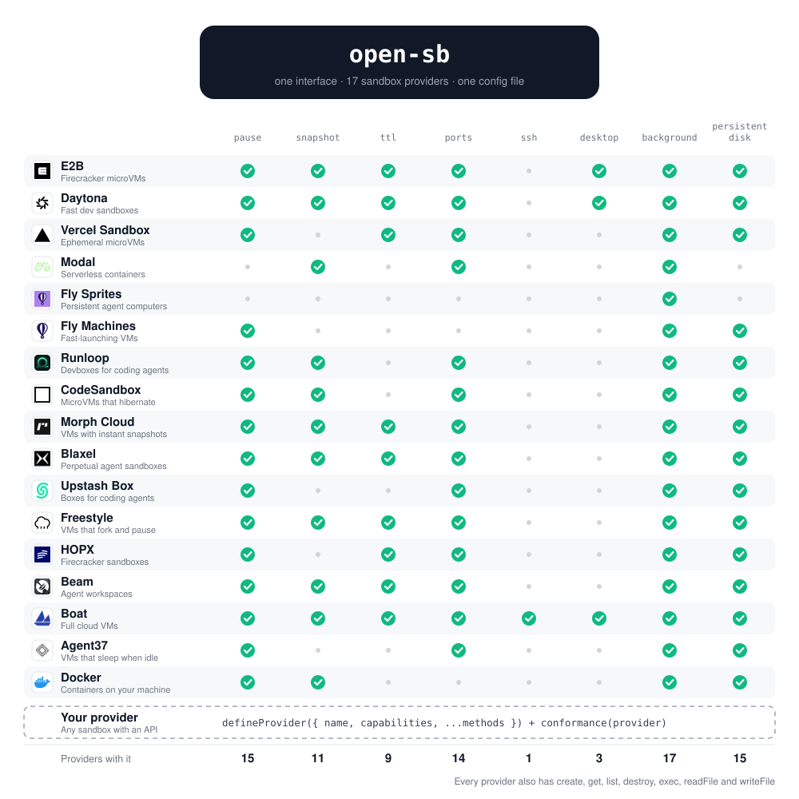

<p align="center">
  
</p>

<h1 align="center">open-sb</h1>

<p align="center">
  <b>One TypeScript interface for agent sandboxes.</b><br>
  Pick your providers in a config file, say which features you need, and know before production whether they all have them.
</p>

<p align="center">
  <a href="https://github.com/invertix-ai/open-sb/actions/workflows/ci.yml"></a>
  <a href="LICENSE"></a>
  
</p>

---

AI agents need somewhere to run code: a VM or container they can start, run commands in, pause, and come back to.
Every provider has its own API, its own words for the same things, and its own gaps. Switching providers, or
keeping a second one ready for when the first is down, means rewriting the glue each time.

open-sb is that glue, written once. Think of it as OpenTofu for agent sandboxes: a config file lists the
providers, and every provider speaks the same interface. It ships with **17 providers**: E2B, Daytona, Vercel
Sandbox, Modal, Fly Sprites, Fly Machines, Runloop, CodeSandbox, Morph Cloud, Blaxel, Upstash Box, Freestyle,
HOPX, Beam, Boat, Agent37 and Docker. Every integration makes the next switch cheaper.

- **One interface.** `create`, `exec`, `readFile`, `writeFile` and friends work the same on every provider.
- **Capabilities you can check.** Pause, snapshots, SSH, port URLs and more are declared per provider, and a
  missing one is caught at three points: when you type-check, when your app starts, and in CI.
- **Failover built in.** List providers in order. When the first has an outage, work moves to the next.
- **Honest providers.** A shared conformance suite runs against real sandboxes, so a provider cannot claim a
  capability it does not have.

## Quick start

```ts
// sandbox.config.ts
import { defineConfig } from "@invertix/open-sb";
import { e2b } from "@invertix/open-sb/e2b";
import { daytona } from "@invertix/open-sb/daytona";

export default defineConfig({
  // What your application needs from every provider.
  requires: ["pause", "persistentDisk", "background"],
  // Tried in order: Daytona takes over when E2B is down.
  providers: [
    e2b({ apiKey: process.env.E2B_API_KEY }),
    daytona({ apiKey: process.env.DAYTONA_API_KEY }),
  ],
});
```

```ts
import { assertCompatible, failover } from "@invertix/open-sb";
import config from "./sandbox.config.ts";

assertCompatible(config); // throws at startup if a provider lacks a required capability

const { provider, result: sandbox } = await failover(
  config,
  provider => provider.create({ labels: { agent: "a1" } }),
  { onFallback: ({ from, to }) => console.warn(`${from} is down, using ${to}`) },
);

const { stdout } = await provider.exec(sandbox.id, "echo hello");
await provider.writeFile(sandbox.id, "/home/user/notes.txt", "remember this");
await provider.pause(sandbox.id); // typed: every provider in this config has `pause`
```

Add Modal (no `pause`) to that config and `tsc` fails before anything runs.

## Three checks, one source of truth

| When | How | Catches |
| --- | --- | --- |
| Type-check | `defineConfig` and `defineProvider` | A provider missing a required capability, or declaring one without its methods |
| Startup | `assertCompatible(config)` | The same, for JavaScript and providers loaded at runtime |
| CI | `conformance(provider)` | A provider whose capability does not actually work against the real service |

From the command line:

```sh
pnpm exec open-sb check
```

```
capability       e2b  daytona
pause*           yes  yes
snapshot         yes  yes
ttl              yes  -
ports            yes  yes
ssh              -    -
desktop          -    -
background*      yes  yes
persistentDisk*  yes  yes
(* required)
```

It exits with code 1 and names the gap when a provider is missing a required capability, so it can gate CI.

## The interface

Every provider implements the core:

| Method | Does |
| --- | --- |
| `create({ image?, labels?, idempotencyKey? })` | Starts a sandbox |
| `get(id)` / `list({ labels })` | Finds sandboxes, by ID or by labels |
| `destroy(id)` | Deletes it; deleting twice is fine |
| `exec(id, command, { cwd?, env?, timeoutMs? })` | Runs a shell command, returns exit code, stdout and stderr |
| `readFile(id, path)` / `writeFile(id, path, data)` | Moves text or binary files in and out |

Optional capabilities:

| Capability | Methods | Meaning |
| --- | --- | --- |
| `pause` | `pause`, `resume` | Sleep and wake; the sandbox keeps its identity |
| `persistentDisk` | | Files survive pause and resume (requires `pause`) |
| `snapshot` | `snapshot`, `listSnapshots`, `deleteSnapshot` | Save a sandbox as a named image; `create({ image })` starts from it |
| `ttl` | `setTtl` | The provider ends the sandbox on its own (stops or deletes it, per provider); `get()` reports `expiresAt` |
| `ports` | `portUrl` | A private HTTPS address for a port inside the sandbox |
| `ssh` | `ssh` | An SSH endpoint and host key for a public key you supply |
| `desktop` | `desktop` | A viewer URL for a graphical desktop |
| `background` | `startBackground` | A process that keeps running after the call returns |

Every failure is a `SandboxError` with a `kind`: `unavailable` (an outage, so failover moves on), `not_found`,
`rejected` or `timeout`. Provider error bodies never leak into messages.

## Providers

| Provider | Import | Install | Capabilities | Live conformance |
| --- | --- | --- | --- | --- |
| [E2B](https://e2b.dev) | `@invertix/open-sb/e2b` | `e2b` | pause, persistentDisk, snapshot, ttl, ports, background | not run yet |
| [Daytona](https://daytona.io) | `@invertix/open-sb/daytona` | `@daytonaio/sdk` | pause, persistentDisk, snapshot, ttl, ports, background | not run yet |
| [Vercel Sandbox](https://vercel.com/docs/vercel-sandbox) | `@invertix/open-sb/vercel` | `@vercel/sandbox` | pause, persistentDisk, ttl, ports, background | not run yet |
| [Modal](https://modal.com) | `@invertix/open-sb/modal` | `modal` | snapshot, ports, background | not run yet |
| [Fly Sprites](https://sprites.dev) | `@invertix/open-sb/sprites` | `@fly/sprites` (Node 24+) | background | not run yet |
| [Fly Machines](https://fly.io/docs/machines/) | `@invertix/open-sb/fly` | nothing (REST API) | pause, persistentDisk, background | not run yet |
| [Runloop](https://runloop.ai) | `@invertix/open-sb/runloop` | `@runloop/api-client` | pause, persistentDisk, snapshot, ports, background | not run yet |
| [CodeSandbox](https://codesandbox.io/sdk) | `@invertix/open-sb/codesandbox` | `@codesandbox/sdk` | pause, persistentDisk, snapshot, ports, background | not run yet |
| [Morph Cloud](https://cloud.morph.so) | `@invertix/open-sb/morph` | `morphcloud` | pause, persistentDisk, snapshot, ttl, ports, background | not run yet |
| [Blaxel](https://blaxel.ai) | `@invertix/open-sb/blaxel` | `@blaxel/core` | pause, persistentDisk, snapshot, ttl, ports, background | not run yet |
| [Upstash Box](https://upstash.com) | `@invertix/open-sb/upstash` | `@upstash/box` | pause, persistentDisk, ports, background | not run yet |
| [Freestyle](https://freestyle.sh) | `@invertix/open-sb/freestyle` | `freestyle` | pause, persistentDisk, snapshot, ttl, ports, background | not run yet |
| [HOPX](https://hopx.ai) | `@invertix/open-sb/hopx` | `@hopx-ai/sdk` | pause, persistentDisk, ttl, ports, background | not run yet |
| [Beam](https://beam.cloud) | `@invertix/open-sb/beam` | `@beamcloud/beam-js` | pause, persistentDisk, snapshot, ttl, ports, background | not run yet |
| [Boat](https://boat.dev) | `@invertix/open-sb/boat` | `@boatdev/sdk` | all eight | 7 of 11 pass |
| [Agent37](https://agent37.com) | `@invertix/open-sb/agent37` | nothing | pause, persistentDisk, ports, background | passes |
| [Docker](https://www.docker.com) | `@invertix/open-sb/docker` | nothing; needs Docker running | pause, persistentDisk, snapshot, background | passes, every CI run |

Each provider's SDK is an optional peer dependency: install only the ones you use. Docker is handy for local
development and tests: no account, no cost, same interface.

Capabilities are only declared when the provider can honour them exactly; why one is missing is written at the
top of each provider file. A few examples:

- Modal fixes a sandbox's lifetime at creation and cannot extend it, so it has no `ttl`.
- Fly Machines lose their root filesystem on stop, so `pause` uses suspend, which keeps it.
- Fly Sprites suspend themselves when idle and have no pause call, so they offer only the core and `background`.
- Where a provider has no labels or idempotency key, open-sb stores them in names, tags or metadata, and
  `list({ labels })` always filters exactly.

### Add your own

A provider is a function that returns `defineProvider(...)`. List the capabilities it has, and the type checker
insists on their methods:

```ts
import { defineProvider } from "@invertix/open-sb";

export function myCloud(options: { apiKey: string }) {
  return defineProvider({
    name: "my-cloud",
    capabilities: ["pause"] as const,
    async create(opts) { /* ... */ },
    async get(id) { /* ... */ },
    async list(filter) { /* ... */ },
    async destroy(id) { /* ... */ },
    async exec(id, command, opts) { /* ... */ },
    async readFile(id, path) { /* ... */ },
    async writeFile(id, path, data) { /* ... */ },
    async pause(id) { /* ... */ },   // required because of "pause"
    async resume(id) { /* ... */ },
  });
}
```

Then prove it works against the real service:

```ts
// my-cloud.conformance.ts, run with `node --test`
import { conformance } from "@invertix/open-sb/conformance";
import { myCloud } from "./my-cloud.ts";

conformance(myCloud({ apiKey: process.env.MY_CLOUD_KEY! }));
```

The suite creates real sandboxes, tests the core and every capability you declared, and deletes what it made.
Pull requests for new providers are welcome; include a passing conformance run.

## How it compares

Other projects wrap many sandbox providers too, notably [Sandbox SDK](https://github.com/opencoredev/sandbox-sdk)
and [ComputeSDK](https://github.com/computesdk/computesdk). They focus on a rich API for one sandbox at a
time. open-sb focuses on running a fleet across providers:

- **A config with requirements.** Your app states which capabilities it needs, and open-sb proves every
  listed provider has them, at type-check, at startup and with `open-sb check` in CI.
- **Failover.** Providers are tried in order and only outages move on, so a second provider is a real backup.
- **One bar for every provider.** The same conformance suite runs against each real service, so claims are tested, not trusted.

## Status

Early. The interface may still change before 1.0. Every provider is built against its official SDK or API and
has unit tests. Docker and Agent37 pass the live conformance suite, and Boat passes 7 of 11 tests (the rest need
a key with more permissions). The other 14 have their live runs next; the table above shows where each stands.
The package is not on npm yet: it ships TypeScript sources, and a JavaScript build comes with the first release.

## Development

Node 22.18 or later runs the TypeScript directly.

```sh
pnpm install
pnpm run check         # types
pnpm test              # unit tests, no services needed
pnpm run test:docker     # live conformance against local Docker, no account needed
pnpm run test:e2b        # any provider: creates real sandboxes; the key it needs is named at the
                         # top of test/<provider>.conformance.ts
pnpm run graphic         # redraws assets/providers.svg from the providers' capabilities
```

## License

[MIT](LICENSE), by [Invertix](https://invertix.ai).
